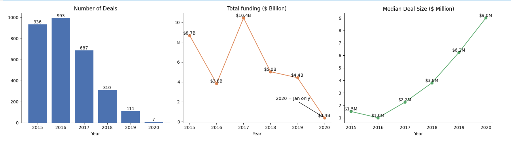
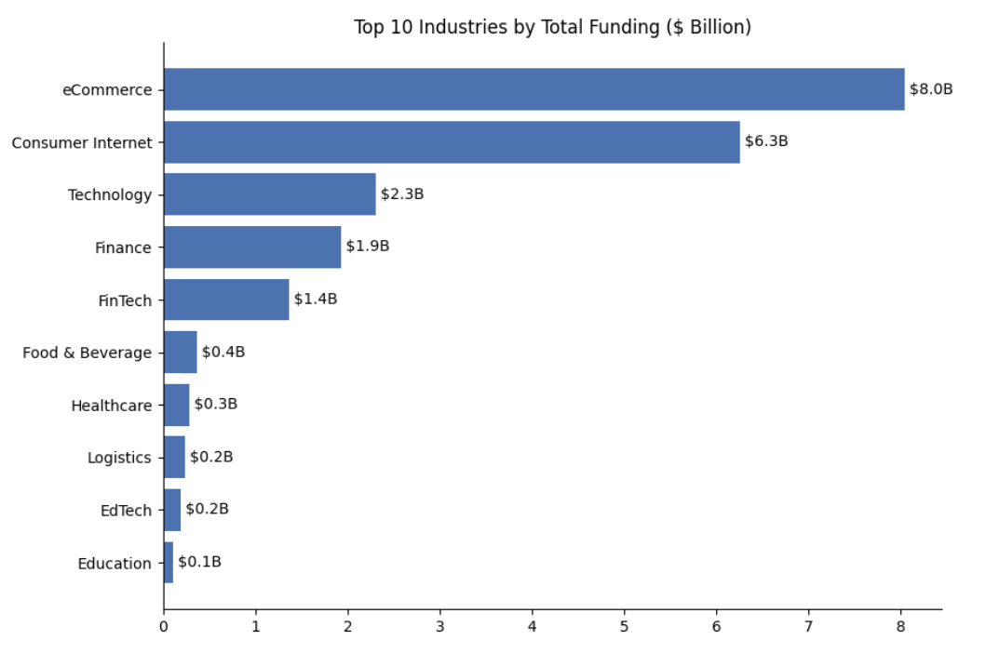
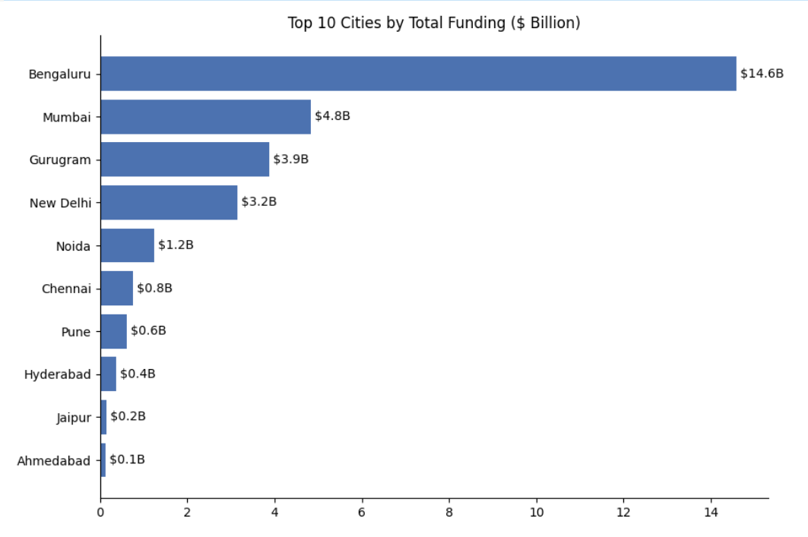
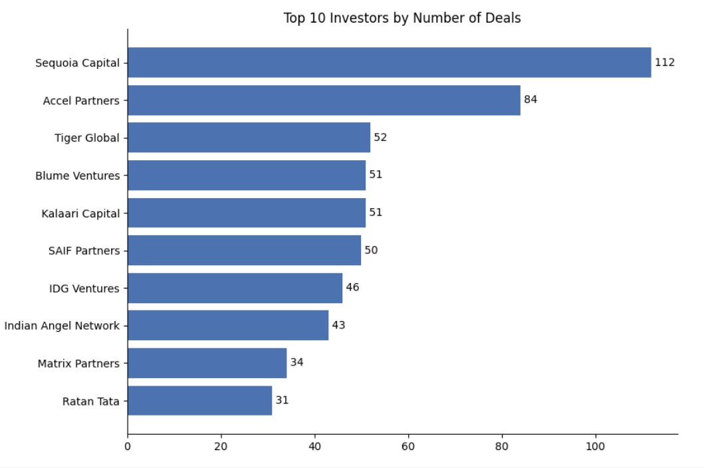
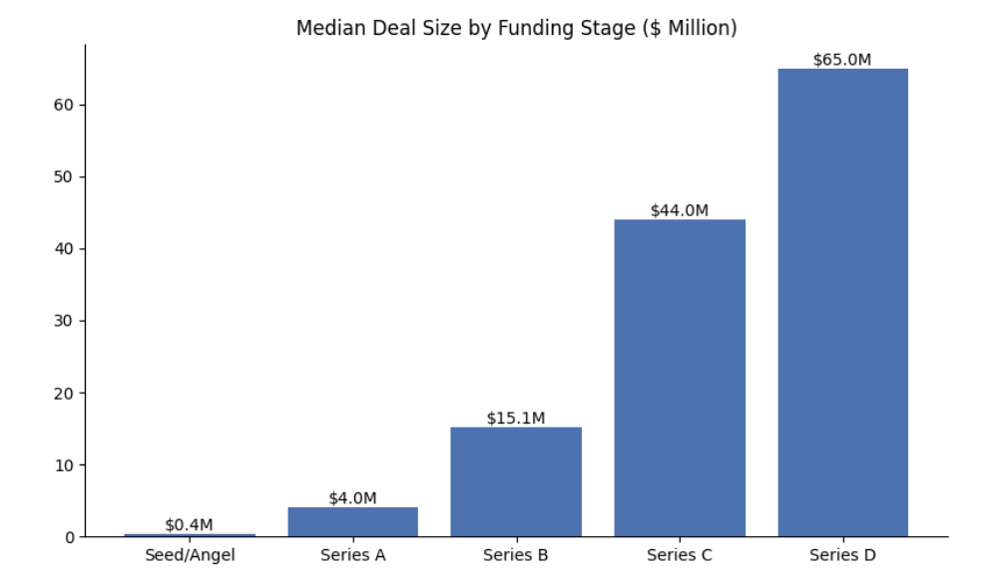
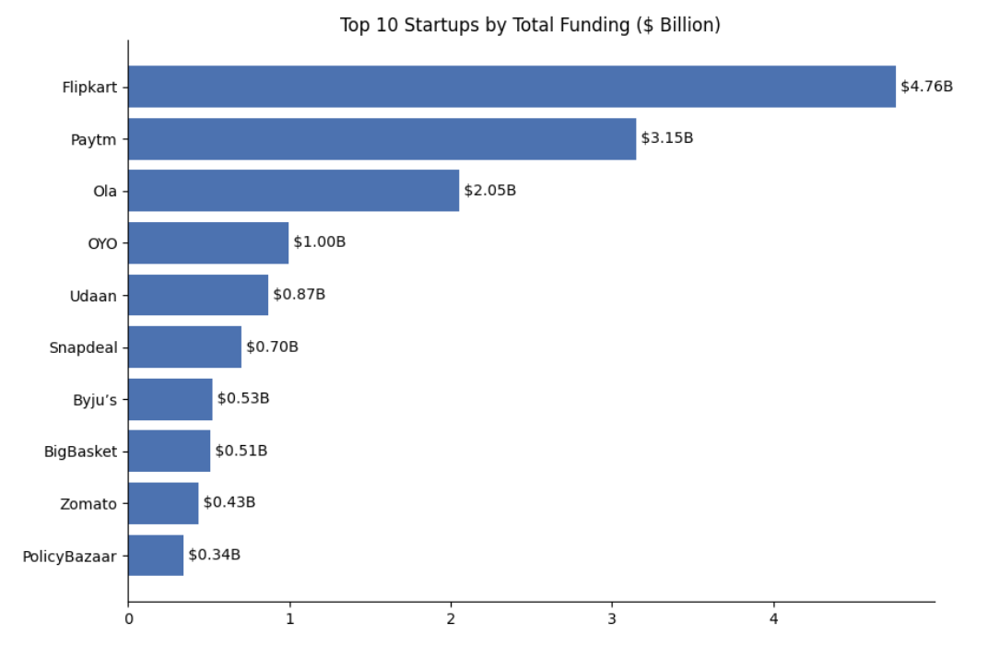

# Indian Startup Funding: Exploratory Data Analysis

**SWYNEX Technologies · Data Analyst Internship · Task 2**


*A cleaned startup-funding table audited for outliers, corrected where evidence exists, and analysed by year, industry, city, investor, funding stage and startup.*

---

## Table of Contents
1. [Project Overview](#1-project-overview)
2. [Dataset](#2-dataset)
3. [Repository Structure](#3-repository-structure)
4. [Key Visuals](#key-visuals)
5. [Data Audit (Before Analysis)](#4-data-audit-before-analysis)
6. [Analysis Workflow](#5-analysis-workflow)
7. [Key Findings](#6-key-findings)
8. [Before vs After](#7-before-vs-after)
9. [Final Data Dictionary](#8-final-data-dictionary)
10. [Decisions & Assumptions](#9-decisions--assumptions)
11. [Limitations](#10-limitations)
12. [How to Reproduce](#11-how-to-reproduce)
13. [Key Learnings](#12-key-learnings)
14. [Next Steps](#13-next-steps)
15. [Author](#14-author)

---

## 1. Project Overview

**Objective:** Use the cleaned dataset from Task 1 to understand Indian startup funding: how funding changed over time, which industries, cities, investors and funding stages matter most, and which startups attracted the largest rounds.

**Approach:** The analysis was done in a Google Colab notebook with `pandas` and `matplotlib`. Every section follows the same pattern: **check the data first, analyse second, state the findings and caveats next to each result.**

**Outcome:**
- **11 wrong funding amounts** (rupee values stored as USD, plus data-entry errors) were found through outlier detection, checked against public news reports and corrected. This removed about **$5.46B** from the total before the fix.
- **Six analyses** (year, industry, city, investor, funding stage, startup) with findings and caveats written next to each result.
- An **analysis-ready table of 3,044 rows × 16 columns** (`startup_funding_eda.csv`) that keeps both the corrected and the original amount, ready for the dashboard stage.

---

## 2. Dataset

| Property | Detail |
|---|---|
| Source | Output of Task 1 (Kaggle Indian startup funding dataset, cleaned) |
| Input file | `cleaned_startup_funding.csv` |
| Input size | 3,044 rows × 10 columns |
| Output file | `startup_funding_eda.csv` |
| Output size | 3,044 rows × 16 columns |
| Period covered | 2 January 2015 to 13 January 2020 |
| Content | Funding rounds of Indian startups: date, company, industry, city, investors, round type, amount in USD |

---

## 3. Repository Structure

```
SWYNEX-Startup-Funding-EDA/
├── cleaned_startup_funding.csv                              # Input: Task 1 output
├── startup_funding_eda.csv                                  # Final analysis-ready data (16 columns)
├── Indian_Startup_Funding_Exploratory_Data_Analysis.ipynb   # Full notebook with every step
├── README.md                                                # This document
└── images/                                                  # Charts used in the README
```

---

## Key Visuals

These charts summarize the core findings from the notebook and are added here for quick visibility in the repository.


### Yearly trend: deals, total funding and median deal size


### Top 10 industries by total funding


### Top 10 cities by total funding


### Top 10 investors by number of deals


### Median deal size by funding stage


### Top 10 startups by total funding


---

## 4. Data Audit (Before Analysis)

Checked using `df.shape`, `df.info()`, `df.isna().sum()`, `(df == 'Unknown').sum()`, `df.duplicated().sum()` and `df.describe()`.

| # | Check | Result |
|---|---|---|
| 1 | Shape | 3,044 rows × 10 columns |
| 2 | Data types | `date` is `datetime64`, `amount_usd` is `float64`, `sr_no` is `int64`, the rest are text |
| 3 | Missing values | Only `amount_usd` has real missing values: **971 rows (31.9%)**, because the amount was never disclosed |
| 4 | `Unknown` placeholder labels | `industry` 171 · `city` 180 · `investment_type` 4 (placeholders from Task 1, kept and excluded per analysis) |
| 5 | Empty strings | 0 in every text column |
| 6 | Duplicate rows | **0** (checked after dropping `sr_no`, which is unique by design) |
| 7 | Skewed amounts | Mean ≈ **$18.4M** against a median of **$1.75M**; maximum **$3.9B**. A few extreme values pull the average far above the typical deal |

**Why the last row matters most:** the gap between mean and median is the first sign that some amounts are wrong or extreme. That is what triggers the outlier work in Section 5.2.

---

## 5. Analysis Workflow

### Step 1: Load and audit
```python
import pandas as pd
df = pd.read_csv('/content/drive/MyDrive/cleaned_startup_funding.csv', parse_dates=['date'])

print(df.shape)
df.info()
print(df.isna().sum())
print((df == 'Unknown').sum())
print('Duplicates:', df.drop(columns='sr_no').duplicated().sum())
df.describe()
```
`parse_dates` restores the `date` column type, because a CSV file does not store data types. Duplicates are checked without `sr_no`, since a serial number would make every row look unique.

### Step 2: Outlier detection and correction

This is the most important step of the project, because wrong amounts change every total that follows.

**2.1 Spot-check the largest values.** The 40 largest amounts were listed, and every deal above $100M was flagged as `suspect` (**56 rows**). Seed/Angel deals of $50M or more were listed separately because they can be plausible but are still worth checking.

**2.2 Outliers within each investment type.** A normal deal size differs by round, so a flat cut-off is unfair. Amounts above `Q3 + 3 × IQR` were flagged **within each investment type**.

```python
def flag(g):
    q1, q3 = g.quantile(.25), g.quantile(.75)
    return g > q3 + 3*(q3 - q1)

df['outlier'] = df.groupby('investment_type').amount_usd.transform(flag)
```
Result: **118 rows flagged** (Private Equity 82, Seed/Angel 28, Series B 3, Other 1, Pre-Series A 1, Series A 1, Series C 1, Series D 1).

**2.3 Manual review.** Flagged rows were reviewed by hand, round by round:

| Round | Flagged | Decision |
|---|---|---|
| Seed/Angel | 28 | The top 5 ($50M to $220M) are far too large for a seed round. The other 23 ($2.4M to $12M) are high but possible, so they were left unchanged |
| Series B | 3 | Vogo Automotive ($283M) and Rapido Bike Taxi ($3.9B) look unrealistic. Automation Anywhere ($300M) is large but possible |
| Other rounds | 5 | GOQii, Recykal and Kuvera were checked against 2019 news reports and marked for verification. Udaan ($585M) and Paytm ($1B) match news reports and were left unchanged |

**2.4 Mark rows to verify.** Ten rows with unrealistic amounts were marked `to_verify`.

**2.5 Fix the wrong amounts.** Each of the 10 rows was checked against public news reports from 2018 and 2019. Most were **rupee amounts stored as USD**; Recykal and Kuvera were data-entry errors.

| Startup | Original amount | Corrected amount | Reason |
|---|---:|---:|---|
| Rapido Bike Taxi | $3,900,000,000 | $54,000,000 | Rs 390 Cr |
| Vogo Automotive | $283,000,000 | $4,000,000 | Rs 28.3 Cr |
| GOQii | $450,000,000 | $6,240,000 | Rs 45 Cr |
| Digital Mall Asia | $220,000,000 | $3,060,000 | Rs 22 Cr |
| FreshVnF | $140,000,000 | $2,000,000 | $2M reported |
| Shape | $100,000,000 | $200,000 | $200K reported |
| Dhruva Space | $50,000,000 | $700,000 | Rs 5 Cr |
| Rein Games | $50,000,000 | $700,000 | Rs 5 Cr |
| Kuvera | $45,000,000 | $4,500,000 | $4.5M reported |
| Recykal | $26,000,000 | $2,000,000 | $2M reported |
| Furtados School of Music | $200,000,000 | $2,800,000 | Rs 20 Cr |

```python
if 'amount_original' not in df.columns:
    df['amount_original'] = df.amount_usd

m = df.to_verify
new = df.loc[m, 'startup_name'].map(fix)
assert new.notna().all(), 'a to_verify row has no fix'
df.loc[m, 'amount_usd'] = new
```
The `assert` stops the notebook if a marked row has no correction, so nothing is changed silently. The 11 corrected rows carried about **$5.46B before** the fix and about **$0.08B after** it.

**2.6 Re-check after the fixes.** The same IQR rule was run again and saved in a new column `outlier_after_fix`, so the first flags stay visible. **110 rows** remain flagged after corrections.

---

## 6. Key Findings

| # | Finding |
|---|---|
| 1 | **Fewer, bigger deals.** Deals fell from 993 (2016) to 111 (2019), while the median deal size rose from $1.0M to $6.2M. Total funding peaked in 2017 ($10.4B) because of a few very large deals. |
| 2 | **Funding is concentrated by industry.** eCommerce ($8.0B) and Consumer Internet ($6.3B) hold about 68% of the top-10 industry funding. |
| 3 | **Bengaluru leads by money, Delhi NCR by deal count.** Bengaluru raised about $14.6B, roughly half of the top-10 city total. |
| 4 | **Stage drives deal size.** The median rises from $0.36M (Seed/Angel) to $4.0M (Series A), $15.1M (Series B), $44.0M (Series C) and $65.0M (Series D). |
| 5 | **Most active investors.** Sequoia Capital (112 deals) and Accel Partners (84) lead, well ahead of Tiger Global (52). |
| 6 | **Top funded startups.** Flipkart ($4.76B), Paytm ($3.15B) and Ola ($2.05B) hold about 69% of the top-10 startup funding. |
| 7 | **Data quality changed the story.** Correcting 11 amounts removed about $5.4B from the total. |

---

## 7. Before vs After

| Check | Before | After |
|---|---|---|
| Shape | 3,044 × 10 | 3,044 × 16 |
| Total funding (`amount_usd`) | $38.14B | $32.76B |
| Mean deal size | ≈ $18.4M | ≈ $15.8M |
| Median deal size | $1.75M | $1.70M |
| Largest single deal | $3.9B (Rapido Bike Taxi) | $2.5B (Flipkart, Aug 2017) |
| Rows flagged as outliers | 118 | 110 |
| Wrong amounts corrected | 0 | 11 |

---

## 8. Final Data Dictionary

| Column | Type | Description |
|---|---|---|
| `sr_no` | int | Original serial number |
| `date` | datetime | Date of the funding round |
| `year` | int | Year taken from `date` |
| `startup_name` | text | Company name as in the cleaned source |
| `startup_clean` | text | Startup name with spelling variants merged |
| `industry` | text | Industry vertical |
| `subvertical` | text | More specific business description |
| `city` | text | City as in the cleaned source |
| `city_clean` | text | City with typos and variants merged |
| `investors` | text | Investor name(s) |
| `investment_type` | text | Standardised round type |
| `amount_usd` | float | Funding amount in USD after correction |
| `amount_original` | float | Funding amount before correction |
| `amount_fixed` | bool | Whether the amount was corrected |
| `outlier_after_fix` | bool | Whether the amount remains an outlier |
| `remarks` | text | Additional notes |

---

## 9. Decisions & Assumptions

- **Outliers are flagged, not deleted.** A row is changed only when public news reports confirm the correct amount.
- **The IQR rule runs within each investment type.**
- **Keep the original next to the fix.**
- **The median is reported next to the total** because a few very large deals dominate totals.
- **Amounts were not imputed.**
- **Minimum sample size:** industries and cities are ranked only if they have at least 10 deals with an amount.
- **Delhi NCR** is defined as New Delhi + Gurugram + Noida.
- **Each investor gets credit for every deal they joined.**

---

## 10. Limitations

- About 32% of `amount_usd` is missing (971 rows), so totals are understated.
- Smaller amount errors may remain.
- 2020 contains only January, so it is not comparable to full years.
- Industry labels are free text and are not fully standardized.
- Some startup and investor names may remain split by spelling variation.

---

## 11. How to Reproduce

1. Clone this repository.
2. Upload `cleaned_startup_funding.csv` (the Task 1 output) to Google Drive.
3. Open `Indian_Startup_Funding_Exploratory_Data_Analysis.ipynb` in Google Colab.
4. Update the file paths in the load cell.
5. Run all cells in order.
6. The final table is written as `startup_funding_eda.csv`.

**Requirements:** Python 3, `pandas`, `matplotlib`.

---

## 12. Key Learnings

- **Check the data before trusting the totals.**
- **A single cut-off does not fit every group.**
- **Flag first, decide second.**
- **Keep the original next to the fix.**
- **Use the median for skewed money data.**
- **Name variants hide real results.**

---

## 13. Next Steps

- Build an interactive dashboard on `startup_funding_eda.csv`.
- Add missing-amount indicators to charts so totals are not misread as complete.
- Merge remaining industry labels such as `EdTech` and `Education` for cleaner segmentation.

---

## 14. Author

**Sushant Kumar Yadav**
Aspiring Data Analyst · B.Com (Hons), University of Delhi

LinkedIn: [www.linkedin.com/in/sushantkumaryadav310899](https://www.linkedin.com/in/sushantkumaryadav310899/)
GitHub: [Skysushant7366](https://github.com/Skysushant7366)
Portfolio: [https://skysushant7366.github.io/Sushant-portfolio/](https://skysushant7366.github.io/Sushant-portfolio/)
*Completed as Task 2 of the Data Analyst Internship at SWYNEX Technologies.*
